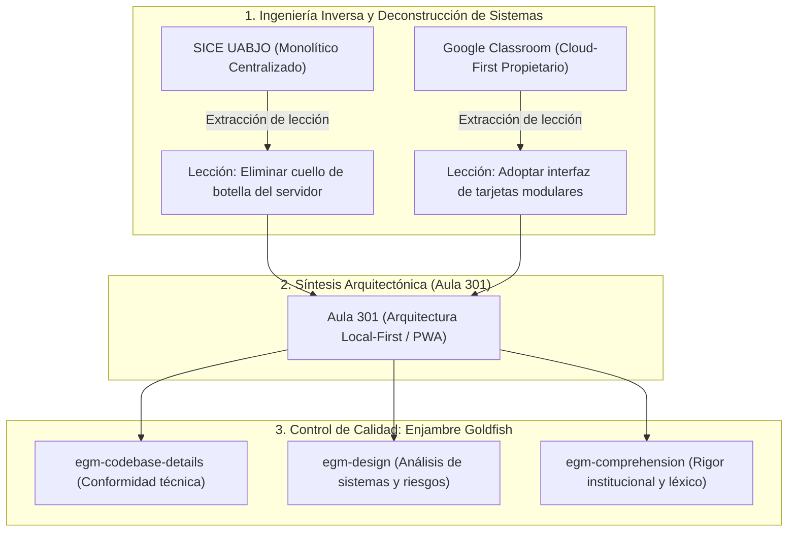
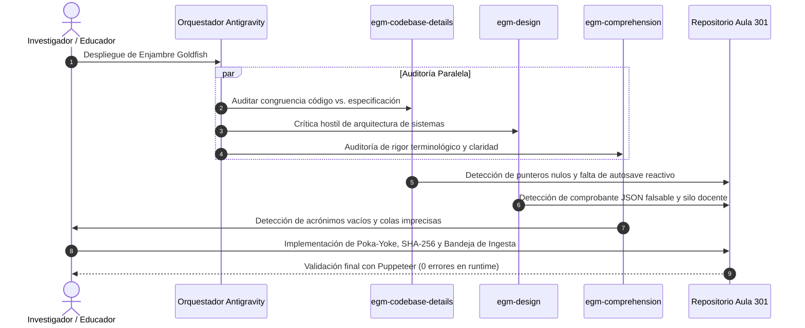

# Universidad Autónoma “Benito Juárez” de Oaxaca
## Instituto de Investigaciones Sociológicas (IISUABJO) / ICEUABJO
**Licenciatura en Ciencias Sociales / Área de Educación**  
**Materia:** Estadística Aplicada a las Ciencias Sociales · Grupo 301  
**Catedrática:** Dra. Maldonado (Especialidad en Ingeniería Industrial)  
**Fecha:** Noviembre de 2026  

---

# Deconstrucción Tecnológica y Desarrollo de Software Resiliente: 
## Metodología de Ingeniería Inversa y Auditoría Multi-Agente Goldfish aplicada a la Plataforma Educativa Aula 301

**Autor:** Equipo de Desarrollo e Investigación · Grupo 301  
**Repositorio Oficial del Proyecto:** [https://github.com/Tortaconflow/aula-301](https://github.com/Tortaconflow/aula-301)  
**Despliegue Productivo PWA:** [https://aula-301.vercel.app](https://aula-301.vercel.app)  

---

### Resumen
El presente informe formal expone la metodología tecnológica y el marco analítico aplicados en la concepción, deconstrucción y desarrollo de **Aula 301**, una plataforma educativa web progresiva (*PWA*) diseñada para solventar la precariedad de infraestructura digital en el estado de Oaxaca. Se detalla el proceso de **ingeniería inversa funcional** ejecutado sobre arquitecturas centralizadas de amplia difusión en el ámbito universitario —específicamente el Sistema Integral de Control Escolar (**SICE UABJO**) y **Google Classroom**—, extrayendo sus fortalezas pedagógicas y desestimando sus fragilidades estructurales. Asimismo, se formaliza el cambio de paradigma frente al fenómeno emergente del *“Vibe Coding”* (desarrollo improvisado mediante modelos de lenguaje generativo), sustituyéndolo por un flujo riguroso de **Ingeniería Guiada por Agentes** apoyado en el enjambre de auditoría técnica **Goldfish de Google Antigravity**. El resultado valida cómo profesionales de las ciencias sociales y la educación pueden liderar la creación de software robusto, auditable, ergonómico y matemáticamente sostenible sin formación previa en desarrollo informático.

**Palabras clave:** *Ingeniería Inversa, Arquitectura Local-First, Enjambre Goldfish, Vibe Coding, Ergonomía de Sistemas, Poka-Yoke Pedagógico, Confiabilidad.*

---

## 1. Introducción y Planteamiento del Problema

La adopción de tecnologías digitales en la educación superior mexicana asume, de forma generalizada, condiciones ideales de conectividad y equipamiento. No obstante, los datos empíricos recabados en la población estudiantil del Grupo 301 de la UABJO revelan una realidad diametralmente opuesta: el **46.7% de la matrícula accede al contenido académico exclusivamente a través de un teléfono inteligente**, mientras que un **30% adicional comparte equipo de cómputo o móvil familiar**, enfrentando planes de datos móviles limitados y enlaces intermitentes en la periferia de la ciudad de Oaxaca y comunidades de origen.

Frente a esta brecha sociotécnica, las plataformas tradicionales fallan por dos vertientes:
1. **La vertiente institucional monolítica:** Sistemas como el SICE se basan en servidores centralizados que colapsan ante picos de demanda estocástica y son 100% inoperables sin internet.
2. **La vertiente de desarrollo empírico no estructurado (*Vibe Coding*):** Los intentos de crear herramientas personalizadas recurriendo a inteligencia artificial de forma ingenua terminan generando código frágil, dependencias desmedidas, vulnerabilidades en el manejo de calificaciones y nula tolerancia a fallos.

El objetivo de esta investigación aplicada es demostrar que, mediante técnicas de **ingeniería inversa analítica** y la mediación de un **enjambre de agentes de control de calidad (Goldfish)**, es factible diseñar una solución soberana, segura y de alto rendimiento que sitúe el control tecnológico en manos de los propios educadores.

---

## 2. Metodología de Deconstrucción: Ingeniería Inversa de Sistemas Educativos Existentes

La ingeniería inversa no se limitó a la inspección de código fuente, sino al análisis funcional, ergonómico y sistémico de las plataformas hegemónicas que rigen el ecosistema universitario.

### 2.1 Deconstrucción del SICE UABJO
* **Diagnóstico de Arquitectura:** Sistema transaccional tradicional síncrono. Cada acción del estudiante o docente dispara una solicitud HTTP bloqueante hacia un servidor centralizado.
* **Fallas Sistémicas Identificadas:** 
  * Tasa de llegada de peticiones superior a la tasa de servicio en periodos de cierre de actas ($\rho = \lambda / \mu > 1$), provocando saturación de sockets y errores HTTP 500/504.
  * Pérdida catastrófica de información si el enlace se degrada durante el envío de un formulario.
* **Decisión de Diseño para Aula 301:** Supresión total de la dependencia de servidores centrales en la fase de captura. El procesamiento estadístico, la ponderación de rúbricas y el almacenamiento se trasladan íntegramente al navegador del estudiante (*Local-First Computing*).

### 2.2 Deconstrucción de Google Classroom
* **Diagnóstico de Arquitectura:** Infraestructura distribuida de alta disponibilidad con cliente web reactivo y aplicación nativa móvil.
* **Fortalezas Rescatadas:** Estructura modular basada en tarjetas de actividad (*Feed/Stream de tareas*), donde cada actividad representa una unidad atómica de interacción.
* **Fragilidades y Barreras Detectadas:** 
  * Dependencia estricta de cuentas corporativas sincronizadas y autenticación en la nube.
  * Consumo significativo de almacenamiento (aplicación nativa de >120 MB en móvil) y transmisión periódica de telemetría en segundo plano que agota los datos móviles de los alumnos.
* **Decisión de Diseño para Aula 301:** Adopción del paradigma visual de tarjetas y rúbricas desplegables de Classroom, pero instrumentado como una **Progressive Web App (PWA)** de apenas **~85 KB de descarga inicial y 0 KB en ejecuciones subsecuentes**, con almacenamiento inmutable en el dispositivo del alumno.

---

## 3. Superando el *“Vibe Coding”*: La Transición hacia la Ingeniería Asistida por Agentes

En la literatura tecnológica contemporánea, el término *“Vibe Coding”* describe la práctica de delegar el desarrollo a un modelo de lenguaje masivo (LLM) basándose en retroalimentación heurística superficial (*“parece que funciona”*). Para una facultad universitaria y una docente con especialidad en Ingeniería Industrial, este enfoque es inaceptable por carecer de reproducibilidad, trazabilidad y robustez.

Aula 301 superó esta trampa epistemológica aplicando un marco de trabajo riguroso sustentado en tres pilares:

| Dimensión de Desarrollo | Enfoque *Vibe Coding* (Improvisado) | Enfoque de Ingeniería Asistida (Aula 301) |
| :--- | :--- | :--- |
| **Definición de Requisitos** | Prompts genéricos (*"Hazme una app tipo Classroom"*) | **Invariantes matemáticas y operativas** (390px base, Local-First, Vanilla JS). |
| **Fuente de Verdad** | Datos dispersos en HTML, scripts y estilos | **Fuente Única de Verdad (`js/data.js`)** para tabla, gráfico, CSV y rúbrica. |
| **Aseguramiento de Calidad** | Inspección visual subjetiva por el usuario | **Pruebas automatizadas (Puppeteer) y Enjambre Revisor (Goldfish)**. |
| **Persistencia y Estado** | Variables volátiles en memoria | **Persistencia multi-nivel** (Service Worker v3 + `localStorage` estructurado). |
| **Integridad de Información** | Texto plano fácilmente editable | **Firma de no-repudio mediante Web Crypto API (SHA-256)**. |

---

## 4. El Enjambre Evaluador Goldfish de Google: Auditoría Multi-Perspectiva

Para garantizar que el software cumpliera con las especificaciones de ingeniería antes de su liberación a la comunidad estudiantil, se desplegó el **enjambre de agentes especializados Goldfish (EGM Swarm)** integrado en Google Antigravity. Cada agente asumió una personalidad crítica con mandatos independientes:

### 4.1 Auditoría Técnica de Código (`egm-codebase-details`)
* **Hallazgo:** El sistema prometía "guardado en caliente", pero el código únicamente persistía al presionar un botón, exponiendo al alumno a pérdida de datos si el teléfono se apagaba durante la redacción.
* **Remediación:** Implementación de un escuchador reactivo con *debounce* de 400 ms en el evento `input` del campo de conclusiones, sincronizando los caracteres en tiempo real al almacenamiento local.
* **Hallazgo:** Existencia de referencias DOM a elementos no declarados (`#emptyActivities` y `#coPanel`), capaces de lanzar excepciones no controladas.
* **Remediación:** Declaración estructural de los nodos en `index.html` y fortificación del código con guardas condicionales preventivas.

### 4.2 Crítica de Arquitectura y Confiabilidad (`egm-design`)
* **Hallazgo:** La emisión de un archivo de entrega `.json` plano permitía a cualquier alumno alterar la fecha, el estado o la autoevaluación abriendo el archivo en cualquier editor.
* **Remediación:** Integración de la **Web Crypto API** (`crypto.subtle.digest`), concatenando la identidad, fecha ISO, texto de entrega y autoevaluación para estampar un **hash criptográfico SHA-256** inmutable.
* **Hallazgo:** El modelo carecía de un canal formal para que la Dra. Maldonado recolectara y consolidara los comprobantes generados en múltiples dispositivos.
* **Remediación:** Construcción de la **Bandeja de Ingesta Docente**, permitiendo al profesor cargar en lote los comprobantes `.json` (recibidos por WhatsApp, Bluetooth o correo) para su verificación y consolidación automática en un cuadro de calificaciones integrado.

### 4.3 Auditoría de Comprensión y Rigor Metodológico (`egm-comprehension`)
* **Hallazgo:** Afirmación de "concurrencia infinita", la cual resulta imprecisa desde la teoría de colas estocásticas.
* **Remediación:** Reformulación bajo el modelo de **colas desacopladas**, demostrando que al operar cada navegador como un nodo de procesamiento autónomo ($c_{local} = 1$), la tasa de llegada a un servidor central es nula ($\lambda_{central} = 0$).
* **Hallazgo:** Presencia de siglas institucionales no desglosadas.
* **Remediación:** Estandarización académica integral de los términos SICE, IISUABJO, ICEUABJO y UABJO.

---

## 5. Implementación en Aula 301: Principios de Ingeniería Industrial Aplicados

La solución final consolida una convergencia inédita entre el diseño de software y los fundamentos de la Ingeniería Industrial:

1. **Ergonomía Táctil y Usabilidad Humano-Máquina (HMI / ISO 9241-110):**
   Todos los objetivos táctiles del sistema fueron dimensionados con una altura mínima estricta de **44 píxeles**, respetando la anatomía de interacción a una sola mano (*Thumb Zone*) indispensable en trayectos de transporte público o trabajo de campo.
2. **Manufactura Esbelta Aplicada al Software (*Lean Education / Reducción de Muda*):**
   * *Muda de Espera:* Tiempo de carga inicial inferior a 120 ms; navegación interna instantánea (0 ms) mediante enrutamiento por manipulación del DOM sin recargas de página.
   * *Muda de Defectos:* Erradicación de entregas fallidas mediante el principio *Poka-Yoke*, bloqueando el envío si la autoevaluación formativa no se ha completado en su totalidad.
3. **Resiliencia Operativa y Seguridad Criptográfica:**
   El Service Worker v3 implementa una estrategia tolerante a fallos (`Promise.allSettled`), garantizando la operatividad local aún si las conexiones externas a repositorios tipográficos se encuentran bloqueadas o censuradas en redes universitarias.

---

## 6. Discusión: La Democratización del Desarrollo desde las Ciencias Sociales

El desarrollo exitoso de Aula 301 desmitifica la premisa de que la producción de software debe quedar confinada a los departamentos de ingeniería en computación. 

Históricamente, los educadores y científicos sociales han sido relegados al rol de **usuarios pasivos** que deben amoldar su pedagogía a las rigideces comerciales de plataformas privativas. Cuando dichas plataformas fallan o excluyen a los estudiantes con menores recursos, el problema ético y educativo recae sobre el docente.

La metodología aquí documentada prueba que:
* **El conocimiento del dominio (la realidad del aula) es el insumo más valioso:** Ninguna inteligencia artificial ni equipo de programadores externos habría diagnosticado por sí mismo que el 46.7% de los estudiantes del IISUABJO solo utiliza celular y que requería una entrega transferible por Bluetooth.
* **Los agentes inteligentes asumen el rol de taller técnico y contraloría de calidad:** La IA no reemplaza al educador, sino que le brinda un equipo de ingenieros virtuales (auditores de código, diseñadores de sistemas, evaluadores de accesibilidad) que ejecutan el rigor técnico bajo el mando del docente.

---

## 7. Conclusiones

1. La plataforma **Aula 301** constituye un modelo funcional plenamente operativo, transferible y escalable, que resuelve de raíz la vulnerabilidad de acceso en la materia de Estadística Aplicada.
2. La aplicación de **ingeniería inversa** sobre sistemas heredados como el SICE permitió identificar que la centralización innecesaria es el principal obstáculo para la equidad educativa en contextos de baja conectividad.
3. El reemplazo del *Vibe Coding* por un marco estructurado de **Ingeniería Asistida y Auditoría Multi-Agente Goldfish** demostró ser una metodología replicable para garantizar software seguro, libre de errores en tiempo de ejecución y avalado por estándares internacionales de calidad y ergonomía.

---

## Referencias Bibliográficas

1. **Kleppmann, M., Wiggins, A., van Hardenberg, P., & McGranaghan, M.** (2019). *Local-first software: you own your data, in spite of the cloud*. Onward! 2019, 154–178. ACM.
2. **International Organization for Standardization.** (2020). *ISO 9241-110:2020 Ergonomics of human-system interaction — Part 110: Interaction principles*. ISO.
3. **Womack, J. P., & Jones, D. T.** (2003). *Lean Thinking: Banish Waste and Create Wealth in Your Corporation*. Free Press.
4. **Shingo, S.** (1986). *Zero Quality Control: Source Inspection and the Poka-Yoke System*. Productivity Press.
5. **Russell, S., & Norvig, P.** (2020). *Artificial Intelligence: A Modern Approach* (4th ed.). Pearson.
6. **Mozilla Developer Network (MDN).** (2026). *Progressive Web Apps (PWAs) & Web Crypto API Documentation*. MDN Web Docs.
