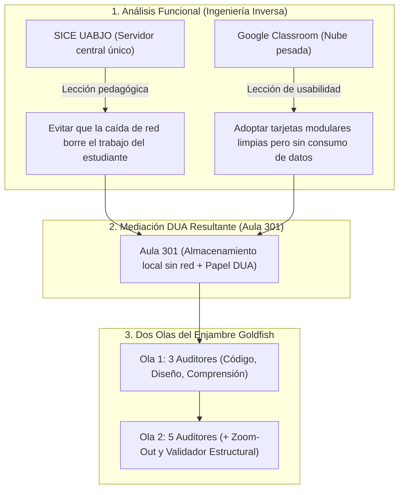

# Metodología de Ingeniería Inversa (REA) y Auditoría Multi-Agente Goldfish aplicada a Aula 301

> **Nota de Adscripción Disciplinar (Anexo Técnico-Metodológico):**  
> El documento rector del proyecto es [MARCO_PEDAGOGICO_Y_ADECUACION_CURRICULAR.md](MARCO_PEDAGOGICO_Y_ADECUACION_CURRICULAR.md), escrito desde las **Ciencias de la Educación** (DUA, BAP y Aprendizaje Situado). El presente anexo documenta cómo se evitó el *“vibe coding”* al construir la mediación digital para el **IISUABJO (UABJO)** en la UCA *Estadística Aplicada a las Ciencias Sociales* (`DI-EAC-03`), bajo la orientación de calidad de procesos de la **Dra. Maldonado**.

**Autor:** Grupo 301 · Licenciatura en Ciencias Sociales y Estudios Políticos  
**Institución:** Instituto de Investigaciones Sociológicas (IISUABJO) — UABJO, Oaxaca  
**Repositorio Oficial:** [https://github.com/Tortaconflow/aula-301](https://github.com/Tortaconflow/aula-301)  
**Sitio Web Accesible:** [https://aula-301.vercel.app](https://aula-301.vercel.app)

---

## 1. Resumen

Este informe expone el proceso por el cual un estudiante o educador sin formación en ingeniería de sistemas puede dirigir la creación de una herramienta didáctica segura y ligera para contextos de baja conectividad en Oaxaca. A partir de una **deconstrucción funcional (Ingeniería Inversa / REA)** de plataformas existentes como el **SICE UABJO** (*Sistema Integral de Control Escolar*) y **Google Classroom**, se descartaron sus barreras de conectividad obligatoria y alto consumo de memoria. Posteriormente, para superar los riesgos del *“vibe coding”* (programación improvisada sin rigor pedagógico ni control de fallos), el repositorio fue auditado en **dos olas sucesivas** por el **Enjambre de Agentes Goldfish (`egm-*`) de Google Antigravity**, cuya segunda ola de cinco auditores permitió detectar y corregir discrepancias curriculares, exceso de jerga informática, regresiones de código y capturas visuales obsoletas.

---

## 2. Deconstrucción Funcional (Ingeniería Inversa): SICE UABJO y Google Classroom

### 2.1 SICE UABJO
* **Problema detectado:** Modelo cliente-servidor síncrono donde la tasa de llegada de peticiones supera la capacidad de servicio en periodos pico ($\rho = \lambda / (c\mu) \ge 1$), generando saturación y pérdida de formularios cuando se interrumpe la señal.
* **Decisión en Aula 301:** Desacoplar la entrega en cada terminal local ($\lambda_{central} = 0$ en captura; nodo autónomo $c_{local} = 1$), de modo que ningún alumno pierda su análisis estadístico por fallas del servidor o del Wi-Fi universitario.

### 2.2 Google Classroom
* **Aporte rescatado:** Organización modular mediante tarjetas de actividad desplegables (*Activity Cards*).
* **Barrera detectada:** Exige cuentas corporativas sincronizadas, descarga pesada en celular y conectividad continua, excluyendo en nuestro caso modelo al 46.7 % que solo usa teléfono inteligente.
* **Decisión en Aula 301:** Aplicación web progresiva (*PWA*) sin dependencias externas ni librerías pesadas, compatible incluso abriendo directamente `index.html` desde memoria USB (`file://`) o imprimiendo en papel.

---

## 3. Superación del *“Vibe Coding”* desde las Ciencias de la Educación

| Dimensión | *Vibe Coding* (Improvisado) | Ingeniería Pedagógica Asistida (Aula 301) |
| :--- | :--- | :--- |
| **Gobierno del diseño** | Prompts vagos (*"Haz una app bonita"*) llenos de librerías pesadas. | **Las Ciencias de la Educación mandan:** DUA, BAP, 6 Tablas de la UCA y práctica en papel. |
| **Consistencia de datos** | Textos y cifras duplicadas con contradicciones entre vistas. | Fuente Única de Verdad en `js/data.js` (`window.AULA301_DATA`). |
| **Verificación real** | *"Parece que funciona"* en una laptop rápida con internet. | Pruebas con navegador automatizado (Chrome/Puppeteer), validación en `file://` y revisión de 5 agentes Goldfish. |
| **Integridad de entrega** | Archivos planos fáciles de corromper o perder al enviarse. | Huella de control SHA-256 canónica con respaldo en JS puro (funciona sin HTTPS) e ingesta unificada docente. |

---

## 4. Auditoría Multi-Agente Goldfish: Primera y Segunda Ola

### 4.1 Primera Ola (3 Agentes Iniciales)
* `egm-codebase-details`: Detectó referencias nulas en DOM y falta de autoguardado reactivo real. Se añadieron guardas y autoguardado cada 400 ms.
* `egm-design`: Señaló comprobantes vulnerables y ausencia de cierre docente. Se incorporó Web Crypto SHA-256 y la bandeja de carga docente.
* `egm-comprehension`: Exigió sustituir *"concurrencia infinita"* por el modelo formal de colas desacopladas y desglosar siglas institucionales.

### 4.2 Segunda Ola Integral (5 Agentes sobre Adecuación Curricular y Baja Gama en Oaxaca)
Tras incorporar las 6 tablas del documento de adecuación curricular del IISUABJO y reenfocar el proyecto hacia Ciencias de la Educación, se desplegaron **cinco auditores en paralelo**: `egm-zoom-out`, `egm-comprehension`, `egm-structural`, `egm-design` y `egm-codebase-details`. Sus hallazgos críticos y las correcciones aplicadas fueron:

1. **Enfoque disciplinar y comprensibilidad (`egm-comprehension`):**
   * *Hallazgo:* La documentación y el 40 % del *Banco de 100 Preguntas* estaban invadidos por jerga de programación e IA (`Puppeteer`, `390px`, `egm-*`), faltaba un documento rector de Ciencias de la Educación y la interfaz mostraba siglas/tecnicismos sin explicar (`Offline-First`, `Poka-yoke`, `JSON.stringify`).
   * *Solución implementada:* Redacción de `MARCO_PEDAGOGICO_Y_ADECUACION_CURRICULAR.md`; traducción completa de botones, avisos y tarjetas de la bandeja docente a lenguaje humano; glosa pedagógica explícita para *Locus de enunciación* y *Glosario breve* integrado en *Recursos y Tablas*; y reescritura completa de `BANCO_100_PREGUNTAS_AULA301.md`.
2. **Error estadístico y omisión de minicasos (`egm-design`, `egm-comprehension`, `egm-structural`):**
   * *Hallazgo:* El Minicaso 1 pedía tendencia central y dispersión teniendo solo una variable cualitativa nominal (dispositivos); el Minicaso 2 no era una matriz de contingencia real 3 × 2; y *Mis calificaciones* solo mostraba 2 actividades (`0 de 2`) y dejaba deshabilitados los Minicasos 2 y 3.
   * *Solución implementada:* Inclusión de variable cuantitativa complementaria en el Minicaso 1 (*horas semanales de conexión estable*, `n = 30`, media 6.20 h, mediana 5.5 h), matriz bivariada real 3 × 2 en el Minicaso 2, habilitación dinámica de los **3 minicasos** desde `js/data.js` y actualización dinámica de *Mis calificaciones* (`X de 3 minicasos`).
3. **Bugs funcionales críticos y compatibilidad con equipos escolares lentos (`egm-codebase-details`, `egm-design`, `egm-zoom-out`):**
   * *Hallazgo:* `setupCsvDownload()` buscaba `minicaso.total` en lugar de `totalCasos` produciendo `NaN` en el CSV; Google Fonts bloqueaba la carga sin internet; `async/await` y `100dvh` sin respaldo rompían navegadores viejos o `file://`; el ingreso por nombre colisionaba homónimos y el SHA-256 omitía fecha/actividad/estado; `<small>` rompía la caja del login y la leyenda larga desbordaba el círculo de calificaciones; faltaba soporte para WhatsApp WebView, entregas en papel (`@media print` + captura manual docente) y persistencia en la bandeja docente.
   * *Solución implementada:* Corrección de descarga CSV con BOM UTF-8 (`\uFEFF`); eliminación de fuentes remotas externas y degradación ligera sin GPU pesada (`sw.js` `v6` *Stale-While-Revalidate*); implementación de SHA-256 canónico con respaldo síncrono en JS puro (sin `async/await`) que incluye matrícula, estudiante, ID/título de actividad, estado, fecha ISO, texto y autoevaluación ordenada; login por matrícula + nombre + equipo compartido; botón **"Copiar texto para WhatsApp"**; hoja imprimible DUA; y bandeja docente con Drag & Drop, pegado de WhatsApp, registro de libreta en papel, notas/observaciones persistentes y concentrado CSV.
4. **Capturas visuales obsoletas y desajuste de diapositivas (`egm-structural`, `egm-codebase-details`):**
   * *Hallazgo:* Las capturas `01`–`06` pertenecían a una versión anterior (`06_docente_ingesta.png` ni siquiera mostraba la bandeja docente) y el deck presentaba texto pequeño para proyectores VGA 4:3.
   * *Solución implementada:* Re-captura automatizada en Chrome headless de **7 pantallas reales** (`01` a `07`, incluyendo la Bandeja Docente activa y el Visor de las 6 Tablas), actualización de `generate_deck.py` con rutas portables y tipografía universal `Arial` >= 12 pt, generación del `.pptx` de 13 láminas y exportación verificada de respaldo en `.pdf` mediante LibreOffice.

---

## Referencias

1. **IISUABJO - UABJO.** (2023). *Secuencia Curricular de Aprendizaje: Estadística Aplicada a las Ciencias Sociales (`DI-EAC-03`)*.
2. **Montoya Naguas, T. M. et al.** (2024). El Diseño Universal de Aprendizaje (DUA), un modelo para la inclusión educativa. *Ciencia Latina*, 8(4), 10905–10920.
3. **Kleppmann, M. et al.** (2019). *Local-first software: you own your data, in spite of the cloud*. ACM Onward! 2019.
4. **ISO.** (2020). *ISO 9241-110:2020 Ergonomics of human-system interaction*.
5. **Shingo, S.** (1986). *Zero Quality Control: Source Inspection and the Poka-Yoke System*. Productivity Press.
