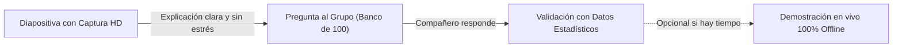

# Protocolo de Presentación y Simulación Segura: Aula 301
## Estrategia Anti-Fallos para Demostración en el Aula
**Materia:** Estadística Aplicada a las Ciencias Sociales · Grupo 301  
**Catedrática:** Dra. Maldonado  
**Objetivo:** Garantizar el 100% de éxito en la exposición pública eliminando la dependencia de internet en vivo, fallas de proyectores o bloqueos de red en la universidad.

---

## 1. La Regla de Oro: La Falacia de la "Demo en Vivo sin Red de Seguridad"

En el ámbito de la inteligencia artificial y el desarrollo de software, la causa número 1 de fallos en presentaciones presenciales es **intentar ejecutar todo en vivo dependiendo de la red del recinto**:
* La red Wi-Fi universitaria suele estar saturada o bloquear puertos.
* Los navegadores pueden quedar en blanco si hay cortes momentáneos.
* El proyector puede cambiar la resolución y desbordar los elementos si no están preparados.

### La Solución Profesional: Simulación Basada en Evidencia (*The Evidence-First Slide Deck*)
El expositor profesional **no improvisa**. Presenta la plataforma con **capturas de alta definición de cada paso crítico**, y mantiene la aplicación corriendo en segundo plano en modo avión (offline) únicamente como respaldo para quien pida verlo en vivo.

---

## 2. Galería de Capturas Oficiales Generadas para Diapositivas

Las siguientes capturas fueron tomadas automáticamente en resolución estándar de visualización y se encuentran listas en la carpeta local `docs/presentacion/capturas/`:

1. **Pantalla de Inicio de Sesión (`01_login_view.png`):**
   * *Qué mostrar en la diapositiva:* El formulario de bienvenida con campos ergonómicos para matrícula y contraseña, y la nota de modelo de demostración sin riesgo de robo de identidad.
2. **Pantalla Principal de Inicio (`02_inicio_home.png`):**
   * *Qué mostrar en la diapositiva:* La estética *glassmorphism*, el saludo personalizado a Carlos Arturo, la barra de avisos con megáfono y la leyenda institucional sin duplicidad de enlaces.
3. **Pestaña "Mis Actividades" (`03_actividades_cards.png`):**
   * *Qué mostrar en la diapositiva:* La distribución de tarjetas limpias (Actividad 1 y Actividad 2) con sus respectivos estados (*Pendiente* y *Próxima semana*).
4. **Espacio de Trabajo del Minicaso 1 (`04_workspace_minicaso.png`):**
   * *Qué mostrar en la diapositiva:* La tabla de distribución de frecuencias ($N = 30$), la gráfica reactiva de barras proporcionales, el botón de descarga CSV y la rúbrica formativa con la autoevaluación.
5. **Pestaña "Mis Calificaciones" Actualizada (`05_calificaciones_resumen.png`):**
   * *Qué mostrar en la diapositiva:* El círculo con la calificación proyectada de **10.0**, la métrica *1 de 2 entregadas*, el estatus *Al corriente* y el desglose de la entrega.
6. **Bandeja de Ingesta Docente (`06_docente_ingesta.png`):**
   * *Qué mostrar en la diapositiva:* La herramienta que permite a la Dra. Maldonado cargar los archivos `.json` enviados por los alumnos por WhatsApp o Bluetooth y auditar el hash criptográfico SHA-256.

---

## 3. Estructura Recomendada de Diapositivas (12 Láminas de Alto Impacto)

* **Lámina 1: Portada Institucional:**
  * Título: *Aula 301: Plataforma Educativa Descentralizada y Resiliente*.
  * Materia: Estadística Aplicada a las Ciencias Sociales · Grupo 301 (IISUABJO / UABJO).
  * Ponente y Catedrática: Dra. Maldonado.
* **Lámina 2: El Diagnóstico Empírico (La Realidad del Aula):**
  * Gráfico del Minicaso 1: 46.7% celular exclusivo, 30% compartido, 23.3% PC propia.
  * *Pregunta al grupo (Pregunta #4 del banco):* "¿Qué porcentaje del grupo depende únicamente del celular?"
* **Lámina 3: La Falla de los Sistemas Actuales (SICE y Classroom):**
  * Cuellos de botella en fechas límite, caídas de red y pérdida de tareas a mitad del envío.
* **Lámina 4: El Cambio de Paradigma: Superando el "Vibe Coding":**
  * Comparación entre programar a ciegas con IA vs. diseñar con reglas de Ingeniería Industrial.
* **Lámina 5: La Arquitectura Local-First y PWA:**
  * Cero servidores para entregar tareas. Funcionamiento al 100% en modo avión.
* **Lámina 6: Demostración Visual 1 — Acceso y Bienvenida (Capturas 01 y 02):**
  * Explicación de la ergonomía móvil y diseño estático sin scroll innecesario.
* **Lámina 7: Demostración Visual 2 — Espacio de Trabajo Estadístico (Capturas 03 y 04):**
  * Tabla de frecuencias, gráfica interactiva y descarga de CSV.
* **Lámina 8: Calidad y Prevención de Errores (*Poka-Yoke Pedagógico*):**
  * La rúbrica formativa obligatoria y el guardado automático de borrador en caliente.
* **Lámina 9: Seguridad y No-Repudio (Sello Criptográfico SHA-256):**
  * Cómo se genera la huella digital del trabajo para que no pueda ser alterado en el archivo `.json`.
* **Lámina 10: Demostración Visual 3 — Cierre Docente y Calificaciones (Capturas 05 y 06):**
  * La Bandeja de Ingesta donde el profesor recibe y califica sin servidores escolares.
* **Lámina 11: La Auditoría del Enjambre Goldfish de Google:**
  * Cómo 3 agentes independientes auditaron el código, la arquitectura y el lenguaje antes de liberar la app.
* **Lámina 12: Conclusión y Mensaje Final:**
  * *"La tecnología más avanzada no es la que exige más megas, sino la que garantiza que nadie se quede atrás"*.

---

## 4. Guion para Ejecutar la Simulación en Vivo (Plan de Respaldo)

Si el jurado o la Dra. Maldonado solicitan ver la plataforma funcionando en la pantalla:
1. **Paso 1:** Abre el navegador en [https://aula-301.vercel.app](https://aula-301.vercel.app) o el archivo local `index.html`.
2. **Paso 2:** Activa el **Modo Avión** en la laptop o desconecta el cable de red frente a la clase.
3. **Paso 3:** Recarga la página. Demuestra que abre en menos de un segundo gracias al Service Worker.
4. **Paso 4:** Ingresa con el usuario `Carlos Arturo` y contraseña `1234`.
5. **Paso 5:** Ve a "Mis actividades", abre la Actividad 1, marca la rúbrica y presiona "Registrar entrega final".
6. **Paso 6:** Presiona "Exportar comprobante" y muestra en el proyector el archivo `.json` descargado con su hash SHA-256.
7. **Paso 7:** Cambia al rol "Docente" y muestra cómo la bandeja de ingesta procesa el archivo.
